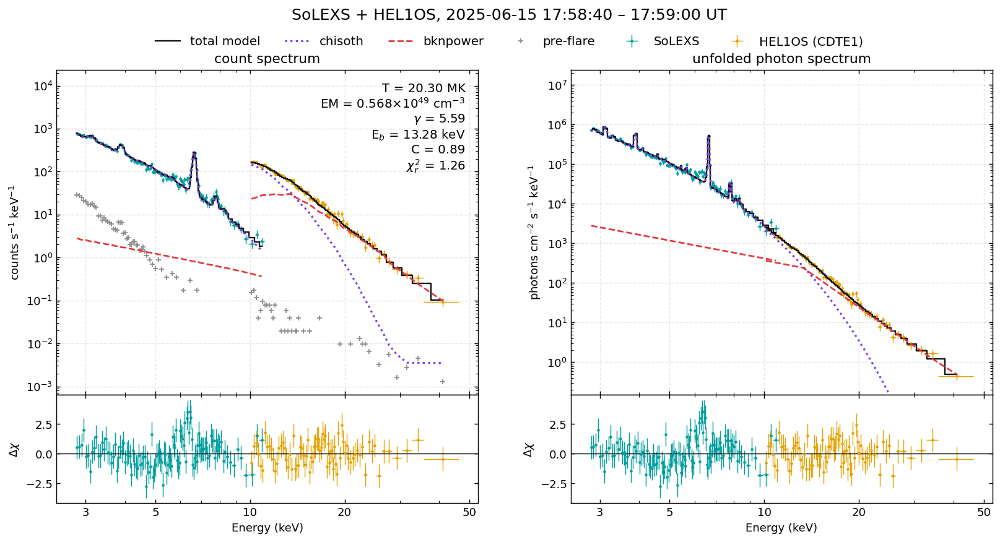
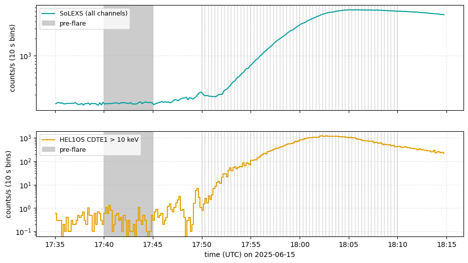
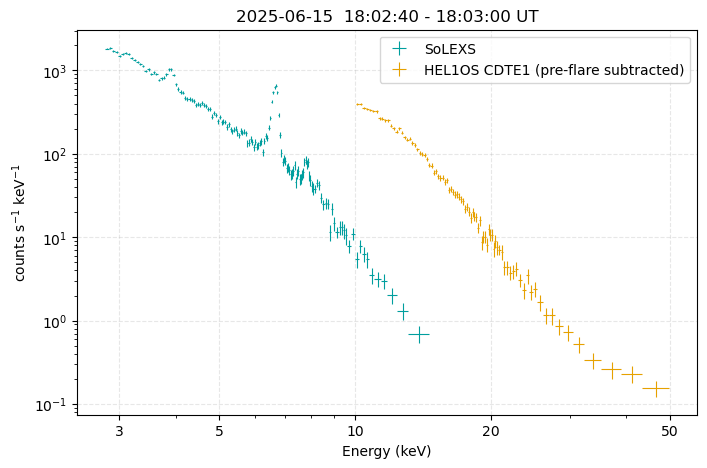

# SoLEXS + HEL1OS: spectra and joint spectral fitting of a solar flare (Aditya-L1)

A complete, ready-to-run example of X-ray spectroscopy of a solar flare with two instruments on board ISRO's
**Aditya-L1**:

* **SoLEXS** (Solar Low Energy X-ray Spectrometer, SDD2): soft X-rays, the hot thermal plasma
* **HEL1OS** (High Energy L1 Orbiting X-ray Spectrometer, CdTe): hard X-rays, the non-thermal tail

This folder contains **everything needed**: the level-1 data of the flare of **15 June 2025**, the calibration
files, the HEL1OS team tools and two notebooks. You only need to install HEASoft, `solexs_tools` and the `chspec`
model (see [Installation](#installation)).

| Notebook | What it does | Time |
|---|---|---|
| [`notebooks/1_make_spectra.ipynb`](notebooks/1_make_spectra.ipynb) | SoLEXS and HEL1OS spectra over the **same time bins**, made with the instrument teams' tools and grouped with `grppha`, ready for XSPEC | ~30 s |
| [`notebooks/2_joint_fit_single_bin.ipynb`](notebooks/2_joint_fit_single_bin.ipynb) | **joint fit of one time bin** with both instruments, from the spectra of notebook 1: fit, MCMC errors, figure | ~1 min |

Run notebook 1 first, then notebook 2.



*Joint fit of the bin 17:58:40–17:59:00 UT. Left: count spectra of SoLEXS (teal) and HEL1OS (orange) with the model
and the residuals. Right: the same, unfolded to photons.*

---

## Repository contents

```
.
├── README.md
├── requirements.txt                       Python packages
├── LICENSE                                MIT License
├── notebooks/
│   ├── 1_make_spectra.ipynb               step 1: spectra for many time bins (teams' tools)
│   └── 2_joint_fit_single_bin.ipynb       step 2: joint fit of one of these bins
├── data/                                  level-1 data of 2025-06-15 (unpacked by the notebooks)
│   ├── AL1_SLX_L1_20250615_v1.0.zip       SoLEXS L1 (spectra + good-time intervals)
│   └── HLS_20250615_121027_42565sec_lev1_V111.zip   HEL1OS level-1 (event list)
├── resources/
│   ├── solexs_caldb/                      SoLEXS calibration (RMF, ARF, channel energies), from solexs_tools
│   └── hel1os_responses/                  HEL1OS CdTe RMF and ARF
├── codes/
│   └── hel1os_tools/                      HEL1OS team tools (unmodified), see its README
│       ├── Evt-To-Mutiple-TypeI_V1.py     event list -> spectra for many time bins (used by notebook 1)
│       ├── evt-to-typeI_V03.py            event list -> one spectrum
│       ├── evt-to-TypeII-V04.py           event list -> Type-II spectra
│       ├── TypeII-to-TypeI-*.py           Type-II -> Type-I spectra (prompt or GUI)
│       └── LcFromEvtFile_V06.py           event list -> light curves
├── figures/                               figures of this README
└── outputs/                               (created by the notebooks)
    ├── spectra/2025-06-15/                spectra of notebook 1
    └── joint_fit/                         fit of notebook 2
```

---

## Installation

| What | Needed for | How |
|---|---|---|
| HEASoft with PyXspec (and `grppha`) | both notebooks | step 1 |
| `chspec` (the `chisoth` model) | notebook 2 | step 2 |
| `solexs_tools` | notebook 1 | step 3 |
| Python packages | both notebooks | step 4 |
| data, calibration files, HEL1OS tools | both notebooks | already in this folder |

Tested on Linux with HEASoft 6.37.1 (XSPEC 13.0.1), Python 3.12 and solexs_tools 1.6.

### 1. HEASoft with PyXspec

PyXspec (`import xspec`) is part of HEASoft. It is **not** available from `pip`.

**Option A: conda (easiest).** HEASARC provides conda packages:

```bash
conda create -n heasoft --override-channels \
    -c https://heasarc.gsfc.nasa.gov/FTP/software/conda/ -c conda-forge \
    heasoft xspec-compilers python=3.12 numpy scipy pandas astropy matplotlib notebook
conda activate heasoft
```

**Option B: build from source**, making sure the Python you use for Jupyter is found during the build (so that
PyXspec is built for it).

* HEASoft: https://heasarc.gsfc.nasa.gov/docs/software/heasoft/
* Installation guide: https://heasarc.gsfc.nasa.gov/lheasoft/install.html
* PyXspec manual: https://heasarc.gsfc.nasa.gov/xanadu/xspec/python/html/index.html

Check:

```bash
python -c "import xspec; print(xspec.Xset.version)"
which grppha
```

### 2. chspec (the `chisoth` model)

`chisoth` is an XSPEC local model from the **chspec** package (developed for Chandrayaan-2 XSM).

* Code: https://github.com/xastprl/chspec
* Model description: Mondal et al. 2021, ApJ, https://doi.org/10.3847/1538-4357/ac14c1

```bash
# with HEASoft initialised (conda activate heasoft, or heainit)
git clone https://github.com/xastprl/chspec.git ~/chspec
cd ~/chspec
./install.sh                    # downloads the CHIANTI spectral table (~3.5 GB) and compiles the model
export CHSPEC_DIR=~/chspec      # add this line to ~/.bashrc
```

Notebook 2 finds chspec through `CHSPEC_DIR` (default `~/chspec`).

### 3. solexs_tools

The SoLEXS team's Python package; notebook 1 uses it to make the SoLEXS spectra.

* Code: https://github.com/abhilash-sw/solexs_tools

```bash
# in the same environment as HEASoft / Jupyter
git clone https://github.com/abhilash-sw/solexs_tools.git
cd solexs_tools
pip install .
```

Use version 1.6 or later (older versions read the times in local time instead of UTC). The SoLEXS CALDB is already
in `resources/solexs_caldb/`; the notebooks point `SOLEXS_CALDB` to it, so you do not need to extract it.

### 4. Python packages

If you did not install them with conda in step 1:

```bash
pip install -r requirements.txt
```

---

## Running

```bash
git clone https://github.com/PrakharSingh14/X-ray_scripts.git
cd X-ray_scripts/SoLEXS_HELIOS_joint_fitting_demo
conda activate heasoft
export CHSPEC_DIR=~/chspec
jupyter notebook
```

Open `notebooks/1_make_spectra.ipynb` and run all cells (*Run → Run All Cells*), then do the same with
`notebooks/2_joint_fit_single_bin.ipynb`. Notebook 1 unpacks the data the first time (about 530 MB); both notebooks
check that every input is in place.

### Notebook 1: spectra for many time bins



| Step | Tool |
|---|---|
| light curves, to check the time bins and the pre-flare window | Python (`astropy`) |
| SoLEXS spectrum of every bin + pre-flare spectrum | `solexs_tools`: `solexs_genmultispec`, `solexs_genspec` |
| HEL1OS spectrum of every bin + pre-flare spectrum | HEL1OS team: `Evt-To-Mutiple-TypeI_V1.py` (the notebook answers its questions) |
| grouping (≥ 20 counts), HEL1OS energy range, HEL1OS background | HEASoft: `grppha` |
| check: load one bin and plot it | PyXspec |

| Setting | Default | Meaning |
|---|---|---|
| `T_START`, `T_STOP`, `BIN_LENGTH` | 17:50:00, 18:10:00, 20 s | time bins (the same for both instruments) |
| `BKG` | 17:40:00 – 17:45:00 | pre-flare window (both instruments) |
| `HLS_DETECTOR` | `'CDTE1'` | HEL1OS detector: `'CDTE1'` or `'CDTE2'` |
| `GROUP_MIN` | 20 | `grppha` minimum counts per group (`None` = no grouping) |
| `HLS_EMIN`, `HLS_EMAX` | 10, 50 keV | HEL1OS channels kept (SoLEXS: 2.8–15 keV, set by `solexs_tools`) |

Outputs in `outputs/spectra/2025-06-15/`:

| File | Content |
|---|---|
| `AL1_SOLEXS_20250615_SDD2_L1_<start>_<stop>.pi` | SoLEXS spectrum of one bin (`_grp.pi` = grouped) |
| `CDTE1_typeI_spectra_<start>_<stop>.fits` | HEL1OS spectrum of the same bin (`_grp.fits` = grouped, background linked) |
| `solexs_bkg.pi`, `CDTE1_typeI_spectra_174000_174500.fits` | pre-flare spectra |
| `spectra_list.csv` | one line per bin: times, counts, grouped file names |



To load one bin in XSPEC, **start XSPEC in `outputs/spectra/2025-06-15/`** (the HEL1OS files name their response and
background without a path):

```
XSPEC12> data 1:1 AL1_SOLEXS_20250615_SDD2_L1_175840_175900_grp.pi 2:2 CDTE1_typeI_spectra_175840_175900_grp.fits
XSPEC12> ignore bad
```

### Notebook 2: joint fit of one bin

**Model:** `constant * (chisoth + bknpower + chisoth_pre)`

| Component | Describes | Free parameters |
|---|---|---|
| `chisoth` | isothermal flare plasma (CHIANTI) | temperature *T*, emission measure *EM*, Ar, Ca, Fe abundances (Ni tied to Fe) |
| `bknpower` | non-thermal emission | index γ above the break, break energy *E*<sub>b</sub>, norm (index 1.5 below the break) |
| `chisoth_pre` | pre-flare Sun in SoLEXS | none (fitted once on the pre-flare spectrum, then frozen; zero for HEL1OS) |
| `constant` | cross-calibration | *C* for HEL1OS (fixed to 1 for SoLEXS) |

The pre-flare emission is **modelled** for SoLEXS and **subtracted** as background for HEL1OS. A 5 % systematic error
is added to the model. Errors are 68 % ranges from an MCMC chain (Goodman-Weare, 16 walkers, 16000 steps, fixed seed).

Input: the grouped spectra of notebook 1 for the chosen bin, and the SoLEXS pre-flare spectrum. The fit range
starts where notebook 1 starts it (SoLEXS 2.8 keV, HEL1OS 10 keV) and ends where the data become too weak.

| Setting | Default | Meaning |
|---|---|---|
| `BIN` | 17:58:40 – 17:59:00 | time bin to fit: one of the bins of notebook 1, in the non-thermal phase |
| `SLX_RATE_MIN`, `SLX_WIDTH_MAX` | 1 count/s/keV, 1 keV | SoLEXS fit range ends at the first group below this rate or wider than this |
| `HLS_SNR_MIN` | 3 | HEL1OS fit range ends at the first group with pre-flare-subtracted counts below 3σ |
| `SYSTEMATIC` | 0.05 | systematic error added to the model |

Outputs in `outputs/joint_fit/`: the MCMC chain (`chain_<bin>.fits`), the figure (`fit_<bin>.png`) and the XSPEC
session (`fit_<bin>.xcm`; reload it with XSPEC started in `notebooks/`: `@../outputs/joint_fit/fit_<bin>.xcm`).

Result for 17:58:40–17:59:00 UT:

| Parameter | Best fit | 68 % range |
|---|---|---|
| *T* | 20.30 MK | 19.90 – 20.54 MK |
| *EM* | 0.568 × 10<sup>49</sup> cm<sup>-3</sup> | 0.556 – 0.588 |
| γ | 5.59 | 5.46 – 5.75 |
| *E*<sub>b</sub> | 13.28 keV | 12.75 – 13.87 keV |
| *C* (HEL1OS/SoLEXS) | 0.89 | 0.84 – 0.95 |
| χ² / dof | 230.2 / 182 = 1.26 | |

The MCMC uses a fixed random seed, so a run gives exactly these numbers.

---

## Notes

* SoLEXS spectra are summed inside the SoLEXS good-time intervals. HEL1OS spectra use the full bin length as
  exposure, with no dead-time correction; in the joint fit the free constant *C* absorbs such differences.
* The SoLEXS spectra contain the full path of the SoLEXS response files on the computer that made them. If you move
  them to another computer, run notebook 1 again there (or edit `RESPFILE` and `ANCRFILE` with `fparkey`).
* **Another day or flare:** download the SoLEXS L1 and HEL1OS level-1 zip files of that day from PRADAN
  (https://pradan.issdc.gov.in/al1/), put them in `data/`, and change `DAY`, the three data file names and the times
  in the first code cell of both notebooks.

## References

* Aditya-L1 data: PRADAN, Indian Space Science Data Centre (ISSDC), ISRO, https://pradan.issdc.gov.in/al1/
* Joint SoLEXS + HEL1OS fitting with `chisoth + bknpower`: Singh, Joshi & Mithun 2026, *Aditya-L1 and SDO
  Observations of a Confined X-Class Flare with an EUV Late Phase*, arXiv:2610.16551
* solexs_tools (SoLEXS team): https://github.com/abhilash-sw/solexs_tools
* HEL1OS tools (HEL1OS team): included unmodified in `codes/hel1os_tools/`
* chspec / `chisoth`: Mondal et al. 2021, ApJ, https://doi.org/10.3847/1538-4357/ac14c1
* CHIANTI atomic database: https://www.chiantidatabase.org/
* XSPEC: Arnaud 1996, ASP Conf. Ser. 101, 17, https://heasarc.gsfc.nasa.gov/xanadu/xspec/

## Acknowledgements

This work uses data from the SoLEXS and HEL1OS instruments on board Aditya-L1, a mission of the Indian Space
Research Organisation (ISRO). We thank the SoLEXS and HEL1OS teams for the data, the calibration files and the
analysis tools.

## License

The notebooks are released under the [MIT License](LICENSE). The data (ISRO / ISSDC), the SoLEXS calibration files,
and the HEL1OS tools and response files belong to their teams and are included only to make the example run.

## Author

**Prakhar Singh**, Aryabhatta Research Institute of Observational Sciences (ARIES), Nainital, India
Email: prakhar.aries@gmail.com
